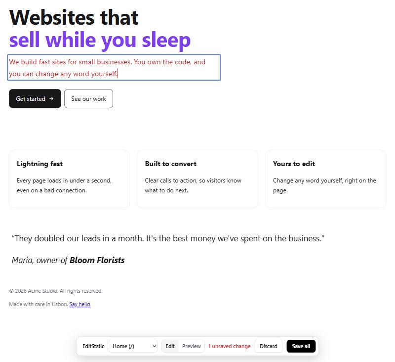

# EditStatic

**Click any text on your site, fix it, press Save. The change lands in your source code.**

AI tools build a whole site in an afternoon. Then you read it and find
"Unlock your potential with seamless solutions" on the home page. Going back to
the AI for every sentence burns credits and often rewrites things you liked.
Opening the code means hunting through components for one string.

EditStatic adds an editor to your **staging** address. Open
`https://staging.your-site/?edit`, enter your password, click a heading, type.
About a minute later the new words are in the right file in your GitHub repo:
a `.tsx` component, a Markdown post, a JSON content file or an HTML page. Your
host then deploys them like any other commit.

- Works with sites made in **Lovable, Bolt, Replit, Claude Code, Cursor, Codex**
  and by hand: React, Vite, Astro, Eleventy, Hugo, plain HTML.
- Runs on **Netlify** or **Cloudflare Pages**. Nothing to install on your
  computer, no database, no account anywhere.
- Your live site never gets an editor. Only the staging deployment has the
  password and the GitHub token.
- Edits go into your real code, so your AI tool keeps working from them. Lovable
  and Bolt pull GitHub changes back in, so once you merge, they see your words.
- Free and open source (MIT). [Support it](#support-editstatic) if it saves you time.



## How it works

1. You open a page on the staging deployment with `?edit`. A small edge
   function (Netlify) or Pages Function (Cloudflare) checks your password and
   adds the editor to the page. On a React app it waits for the app to render,
   then makes every heading, paragraph, button and link label editable.
2. **Save all** sends each change as before/after text. The function queues it
   as a file in your repo (`.editstatic/pending/`) on the staging branch.
3. A GitHub Action runs `editstatic apply`. It finds the one place in your code
   that holds that text, writes the new words there in the right syntax, commits
   and pushes.
4. Your host deploys the commit. The editor bar says **Published**, or why a
   line couldn't be saved.

Edits are matched on the words a visitor reads, not on markup. So
`Websites that <span class="text-primary">sell while you sleep</span>` on the
page is found in

```tsx
<h1 className="text-5xl font-bold">
  Websites that
  <span className="block text-primary">sell while you sleep</span>
</h1>
```

and only the words change. Classes, components, props and formatting stay
exactly as they were. Text that comes from a data array
(`{ title: "Lightning fast" }` rendered as `{f.title}`) is edited in the array.
Quotes, `{braces}` and backticks are escaped for wherever the text sits.

### When it says no

EditStatic won't guess. A refused line stays outlined on the page, with the
reason on hover:

- **The text is in two places**, like a "Get started" button in both the nav
  and the hero. It names both files and lines so you can change the right one.
- **The text is made by code**, like `© {year} Acme`. There's no sentence in a
  file to edit.
- **The formatting changed** (bold, links, line breaks) in a React component or
  Markdown. Only the words can change there. Plain HTML pages accept formatting.

## Set it up

You need the site's code in a GitHub repo, deployed by Netlify or Cloudflare
Pages from a `staging` branch (any name works).

In your repo, on the staging branch:

```bash
npx github:jefvandegraaf/edit-static init --host netlify
```

(or `--host cloudflare`). This adds three files, then prints the remaining steps:

| File | What it is |
| --- | --- |
| `netlify/edge-functions/editstatic.js` or `functions/_middleware.js` | The editor, the login and the save endpoint, in one generated file. |
| `.github/workflows/editstatic.yml` | The Action that writes saved edits into your code. |
| `editstatic.config.json` | Which folders hold text (default: the whole repo) and an optional build command. |

Then, once:

1. **Create a GitHub token** at
   [github.com/settings/personal-access-tokens/new](https://github.com/settings/personal-access-tokens/new):
   only your site's repo, permission **Contents: Read and write**.
2. **Let the Action push**: repo **Settings > Actions > General > Workflow
   permissions > Read and write permissions**.
3. **Add the settings to your staging deployment only.**
   - Netlify: enable branch deploys for `staging`, then add environment
     variables with a value for the **Branch deploys** context only (and the
     Functions scope, if your plan shows scopes). Details: [docs/netlify.md](docs/netlify.md).
   - Cloudflare Pages: **Settings > Variables and Secrets**, **Preview**
     environment only. Details: [docs/cloudflare.md](docs/cloudflare.md).

   | Name | Value |
   | --- | --- |
   | `EDIT_PASSWORD` | a long password you choose (secret) |
   | `GITHUB_TOKEN` | the token from step 1 (secret) |
   | `GITHUB_REPO` | `you/your-site` |
   | `GITHUB_BRANCH` | `staging` |
   | `EDIT_HOST` | your staging hostname, e.g. `staging--your-site.netlify.app` or `staging.your-site.pages.dev` |
   | `EDIT_MODE` | optional: `auto` (default), `static` or `dom` |

4. Redeploy staging. Check `https://<staging>/__es/api/health`: it lists any
   missing setting by name. Then open `https://<staging>/?edit`.

The login lasts 30 days in that browser. Merge staging into your main branch
whenever you're happy, the same as any other change.

**Which tools and hosts work, and how:** [docs/platforms.md](docs/platforms.md)
(Lovable, Bolt, v0, Replit, Claude Code, Cursor and more).

## Check where a text would go

Run this in your repo to see where an edit would be saved, without the browser:

```bash
npx github:jefvandegraaf/edit-static find "Websites that sell while you sleep"
```

```
Would be saved to src/components/Hero.tsx:8
```

## Settings: editstatic.config.json

```json
{
  "sources": ["."],
  "ignore": [],
  "build": null
}
```

- `sources`: folders or files to search for text. The default searches the
  whole repo, minus `node_modules`, build output, lock files and config files.
  Narrow it (`["src", "content"]`) if a folder of examples or fixtures causes
  "in two places" refusals.
- `ignore`: extra folder names or paths to skip.
- `build`: a command the Action runs after applying edits. Only needed if your
  repo contains its built pages (most sites let the host build, so leave it `null`).

Mark parts of a page in HTML or JSX:

- `data-edit="off"` on an element: nothing inside can be edited.
- `data-edit` on an element: its whole inside is one editable block.

## Security

- The editor only exists where `EDIT_PASSWORD`, `GITHUB_TOKEN`, `GITHUB_REPO`
  and `GITHUB_BRANCH` are all set, and only on `EDIT_HOST` when that is set.
  Set them on the staging environment only, and production has no editor at all.
- The login is a password checked at the edge, then an HttpOnly, Secure,
  SameSite=Strict cookie (an HMAC of your password, 30 days). Saves also need
  same-origin requests with a custom header. Use a long password: wrong attempts
  are slowed down, but there is no lockout.
- The GitHub token never leaves the function. Give it access to the one repo,
  Contents only.
- Edited HTML is cleaned before it is written: no scripts, event handlers,
  inline styles or `javascript:` links.
- Saves go to the staging branch. Nothing reaches your live site until you merge.

## Edit a plain HTML folder on your computer

For a plain HTML site (no build step), there's also a local editor that writes
straight into the files, and can commit and push after each save:

```bash
npx github:jefvandegraaf/edit-static local ./my-site --push
```

Then open http://127.0.0.1:8450/. It can also replace images (resized to 2400px,
camera and GPS data stripped). The web version edits text only, for now.

## Limits

- Text only on the web version. Images are next.
- No Next.js/Vercel adapter yet (v0 sites). Help welcome: see
  [docs/platforms.md](docs/platforms.md).
- Formatting changes are saved on plain HTML pages only.
- Translations through i18n keys (`t("hero.title")`) are found when the text is
  in a JSON or JS file, not when it comes from an external service.

## Develop

```bash
npm install
npm test          # core, sync and handler tests
npm run build     # rebuilds dist/ (commit it: init copies from there)
(cd fixtures/react-site && npm install && npx vite build)
node scripts/dev-web.mjs fixtures/react-site --serve dist --build "npx vite build" --host netlify
```

`scripts/dev-web.mjs` runs the real bundle in front of a site folder, with a
stand-in for GitHub that writes queued saves into the folder and runs
`editstatic apply` right away. The password is `dev`.

| Path | What it is |
| --- | --- |
| `packages/core` | Finds editable regions in HTML with exact source offsets; cleans edited HTML. |
| `packages/editor/editor.js` | The in-page editor (bar, click-to-edit, Save all). |
| `packages/sync` | Writes an edit back into source files: JSX/TSX, JS/TS strings, Markdown, YAML/JSON frontmatter, JSON, HTML. |
| `apps/web` | The edge piece (`handler.js`), its Netlify and Cloudflare entries, and the browser loader. |
| `apps/local` | The local editor for plain HTML folders. |
| `fixtures/` | A plain HTML site and a Lovable-style React site, used by the tests. |

## Support EditStatic

EditStatic is free. If it saves you time, you can help keep it going:

- [Leave a tip](https://buy.stripe.com/dRm9ATdXydlL2pq11S38408), any amount from $3
- [Become a Supporter](https://buy.stripe.com/5kQ28r6v62H77JK6mc3840a), $5 a month
- [Become a Patron](https://buy.stripe.com/aFadR93iUdlL4xy25W3840c), $15 a month, with a monthly hangout

Want help setting it up, or a site built for you?
[Get in touch](https://jefvandegraaf.com/contact/).

## License

MIT. Made by [Jef van de Graaf](https://jefvandegraaf.com).

The MIT license covers the code. The EditStatic name and logo are not
included: if you publish your own version, give it a different name.
